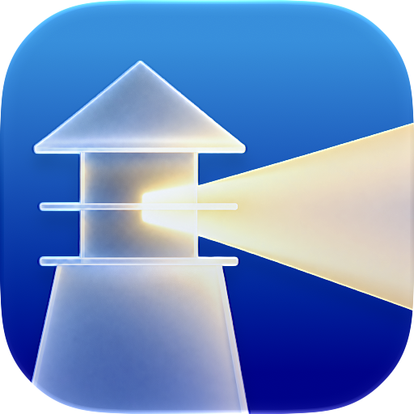

# README

<p align="center">
  
</p>

<h1 align="center">Pharos</h1>

<p align="center">A native macOS client for PostgreSQL and DuckDB, built with Swift and Rust.</p>

---

## Install

### Homebrew (recommended)

```
brew tap NeodymiumPhish/pharos && brew install --cask pharos
```

### Manual Download

Download a `.dmg` from [Releases](https://github.com/NeodymiumPhish/Pharos/releases/latest). The app is unsigned -- after extracting, run:

```
xattr -c Pharos.app
```

Requires macOS 26 (Tahoe) or later. Supports PostgreSQL 10+ servers and DuckDB database files (DuckDB 1.5.6 is built in).

## Features

- **Schema browser** -- Tree view with tables, views, foreign tables, functions, indexes, and constraints. Search bar, row count estimates, table sizes, and context menus (view rows, clone, import, export, copy DDL).
- **SQL editor** -- Syntax highlighting, schema-aware autocomplete, bracket matching, and multi-tab support.
- **Query execution** -- Run and cancel queries with paginated results.
- **Results grid** -- Native table with click-to-sort columns, find-in-results, and display options for grid lines, row numbers, zebra striping, and NULL format.
- **Inspector** -- Single-row detail view and multi-row aggregation with type-aware statistics.
- **Column filters** -- Per-column filter popovers with type-specific operators (text, numeric, boolean, null).
- **Data export** -- Export results or full tables to CSV, TSV, JSON, JSON Lines, SQL INSERT, Markdown, or XLSX.
- **Data import** -- Import CSV files with automatic type inference.
- **Saved queries** -- Organize queries into folders with drag-and-drop.
- **Query history** -- Search and browse past queries with date grouping.
- **Connections** -- SSL support (disable/prefer/require), color-coded server icons, and Keychain password storage.
- **DuckDB** -- Open or create a `.duckdb` file (File ▸ New/Open DuckDB Database…, Open Recent, or from Finder), or use an in-memory database. Built-in extensions: time zones and collations (`icu`), `INET`, full-text search, Excel and SQLite files, JSON, Parquet, files over HTTPS and S3 (`httpfs`), and PostgreSQL databases (`postgres_scanner`). Query cards, history, Sessions, the schema browser, DDL, Explain, charts, export (including Parquet) and CSV import all work. A file another app holds for writing opens read-only on request.
- **SSH tunnels** -- Reach a database behind a bastion. Runs the system `ssh`, so `~/.ssh/config` aliases, `ProxyJump` and a 1Password agent key all apply. Strict host keys by default.
- **Settings** -- A sidebar of sixteen panes covering appearance, the editor, query behaviour, the results grid, the navigators, connections, privacy, notifications and more. Every control applies at once; there is no Save button.

## Build from Source

Requires macOS 26+, Xcode 26+, a [Rust toolchain](https://rustup.rs) (1.88 or later), and CMake and Ninja (`brew install cmake ninja`). The first build compiles DuckDB and its extensions from source (`scripts/build-duckdb.sh`, which also fetches vcpkg for the Excel extension's libraries) and takes several minutes; later builds reuse it.

```
git clone https://github.com/NeodymiumPhish/Pharos.git
cd Pharos
scripts/build-duckdb.sh
cd pharos-core && cargo build --release && cd ..
open Pharos.xcodeproj
```

Build and run with **Cmd+R** in Xcode.

## Stack

AppKit / Swift / Rust / sqlx / DuckDB (duckdb-rs) / cbindgen / SQLite

## Docs

Full documentation at **[neodymiumphish.github.io/Pharos](https://neodymiumphish.github.io/Pharos/)**.

## License

[MIT with Non-Commercial Clause](LICENSE) -- free to use, modify, and distribute, but the software and derivatives may not be sold or commercially monetized without permission.

Pharos contains third-party open-source software (DuckDB, its extensions and their libraries, and the Rust crates of `pharos-core`). [THIRD_PARTY_NOTICES.md](THIRD_PARTY_NOTICES.md) lists each one with its licence; the app shows the same notices in **Settings ▸ About ▸ Third-party notices**.
